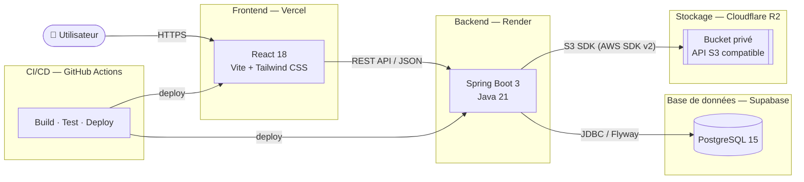

# ☁️ SmartBackup

[](https://github.com/votre-org/smartbackup/actions)
[](LICENSE)
[](https://openjdk.org/projects/jdk/21/)
[](https://nodejs.org/)
[](https://spring.io/projects/spring-boot)
[](https://react.dev/)
[](https://docs.docker.com/compose/)

> **SmartBackup** est une application web full stack de sauvegarde Cloud intelligente qui vous permet de protéger, organiser et restaurer vos fichiers importants depuis n'importe où — avec des sauvegardes manuelles instantanées, des planifications automatiques et un stockage sécurisé sur Cloudflare R2, le tout hébergé sur une stack 100 % free tier (Vercel + Render + Supabase + Cloudflare R2).

---

## 📚 Table des matières

- [Fonctionnalités clés](#-fonctionnalités-clés)
- [Architecture](#-architecture)
- [Prérequis](#-prérequis)
- [Installation et démarrage rapide](#-installation-et-démarrage-rapide)
- [Documentation](#-documentation)
- [Structure du projet](#-structure-du-projet)
- [Contribution](#-contribution)
- [Équipe](#-équipe)
- [Licence](#-licence)

---

## ✨ Fonctionnalités clés

- 🔐 **Authentification sécurisée** — Inscription / connexion avec JWT + BCrypt, refresh tokens
- 📁 **Upload de fichiers** — Glisser-déposer, validation MIME, limite de taille configurable (défaut 50 MB)
- ☁️ **Sauvegarde Cloud** — Stockage chiffré sur Cloudflare R2 avec URL signées temporaires
- 🔁 **Restauration à la demande** — Téléchargement sécurisé de n'importe quelle version
- ⏰ **Planification automatique** — Sauvegardes quotidiennes ou hebdomadaires par scheduler
- 📊 **Versioning** — Historique complet de toutes les versions de chaque fichier
- 🔔 **Notifications** — Alertes en temps réel (succès, échec, planification activée)
- 📋 **Journal d'activité** — Traçabilité complète de toutes les opérations
- 🛡️ **Sécurité renforcée** — Rate limiting, CORS strict, HTTPS obligatoire en production
- 📈 **Monitoring** (post-MVP) — Prometheus + Grafana pour les métriques applicatives

---

## 🏗️ Architecture



---

## 🔧 Prérequis

Assurez-vous que les outils suivants sont installés sur votre machine :

| Outil | Version minimale | Lien |
|-------|-----------------|------|
| Java (JDK) | 21 | [Télécharger](https://adoptium.net/) |
| Node.js | 20+ | [Télécharger](https://nodejs.org/) |
| Docker + Docker Compose | 24+ | [Télécharger](https://docs.docker.com/get-docker/) |
| Git | 2.40+ | [Télécharger](https://git-scm.com/) |

---

## 🚀 Installation et démarrage rapide

### 1. Cloner le dépôt

```bash
git clone https://github.com/votre-org/smartbackup.git
cd smartbackup
```

### 2. Configurer les variables d'environnement

```bash
cp .env.example .env
# Ouvrez .env et renseignez vos valeurs (voir docs/SECURITY.md)
```

### 3. Lancer l'application complète avec Docker Compose

```bash
docker compose up --build
```

L'application sera disponible sur :

| Service | URL locale |
|---------|-----------|
| Frontend (React) | http://localhost:5173 |
| Backend (API) | http://localhost:8080 |
| PostgreSQL local | localhost:5432 |

### 4. (Optionnel) Lancer en mode développement sans Docker

**Backend :**
```bash
cd backend
./mvnw spring-boot:run
```

**Frontend :**
```bash
cd frontend
npm install
npm run dev
```

> [!NOTE]
> En mode développement, assurez-vous que `VITE_API_BASE_URL` dans `.env` pointe vers `http://localhost:8080`.

---

## 📖 Documentation

| Document | Description |
|----------|-------------|
| [PHASE1_ARCHITECTURE.md](docs/PHASE1_ARCHITECTURE.md) | Analyse fonctionnelle, architecture technique, diagrammes, planning |
| [PHASE1_DATABASE.md](docs/PHASE1_DATABASE.md) | Modèle de données, ERD, scripts SQL, migrations Flyway |
| [SECURITY.md](docs/SECURITY.md) | Modèle de menaces, bonnes pratiques, checklist sécurité |
| [API.md](docs/API.md) | Documentation des endpoints REST (OpenAPI / Swagger) |
| [DEPLOYMENT.md](docs/DEPLOYMENT.md) | Guide de déploiement Vercel + Render + Supabase + R2 |
| [TESTING.md](docs/TESTING.md) | Stratégie de tests, couverture, commandes |

---

## 🗂️ Structure du projet

```
smartbackup/
├── .github/
│   └── workflows/
│       ├── backend-ci.yml       # CI backend : build, tests, Docker push
│       └── frontend-ci.yml      # CI frontend : lint, build, deploy Vercel
├── backend/                     # Application Spring Boot
│   ├── src/
│   │   ├── main/
│   │   │   ├── java/com/smartbackup/
│   │   │   │   ├── config/      # Configurations Spring (Security, CORS, R2…)
│   │   │   │   ├── controller/  # REST Controllers
│   │   │   │   ├── dto/         # Data Transfer Objects
│   │   │   │   ├── entity/      # Entités JPA
│   │   │   │   ├── exception/   # Gestionnaires d'exceptions globaux
│   │   │   │   ├── repository/  # Interfaces JPA Repository
│   │   │   │   ├── scheduler/   # Jobs planifiés (@Scheduled)
│   │   │   │   ├── security/    # JWT, filtres Spring Security
│   │   │   │   └── service/     # Couche métier
│   │   │   └── resources/
│   │   │       ├── db/migration/  # Scripts Flyway (V1__…sql)
│   │   │       └── application.yml
│   │   └── test/                # Tests unitaires et d'intégration
│   ├── Dockerfile
│   └── pom.xml
├── frontend/                    # Application React
│   ├── public/
│   ├── src/
│   │   ├── components/          # Composants réutilisables
│   │   ├── hooks/               # Custom React hooks
│   │   ├── pages/               # Pages (Login, Dashboard, Files…)
│   │   ├── services/            # Clients API (Axios)
│   │   ├── store/               # État global (Zustand)
│   │   └── utils/               # Fonctions utilitaires
│   ├── Dockerfile
│   ├── vite.config.ts
│   └── package.json
├── docs/                        # Documentation technique
│   ├── PHASE1_ARCHITECTURE.md
│   ├── PHASE1_DATABASE.md
│   ├── SECURITY.md
│   ├── API.md
│   ├── DEPLOYMENT.md
│   └── TESTING.md
├── docker-compose.yml           # Orchestration locale complète
├── docker-compose.prod.yml      # Surcharge production
├── .env.example                 # Template de variables d'environnement
├── .gitignore
└── README.md
```

---

## 🤝 Contribution

Nous suivons le workflow **GitHub Flow** :

### Branches

| Branche | Rôle |
|---------|------|
| `main` | Code stable, déployé en production |
| `develop` | Branche d'intégration |
| `feature/xxx` | Nouvelles fonctionnalités |
| `fix/xxx` | Corrections de bugs |
| `hotfix/xxx` | Correctifs urgents en production |
| `chore/xxx` | Maintenance, refactoring |

### Workflow Pull Request

1. Créez votre branche depuis `develop` :
   ```bash
   git checkout develop
   git pull origin develop
   git checkout -b feature/ma-fonctionnalite
   ```
2. Développez et committez (convention [Conventional Commits](https://www.conventionalcommits.org/)) :
   ```bash
   git commit -m "feat(backup): add scheduled backup support"
   ```
3. Poussez et ouvrez une Pull Request vers `develop`
4. La PR doit passer les checks CI (build + tests)
5. Revue de code par au moins 1 membre de l'équipe
6. Merge en squash ou rebase

> [!IMPORTANT]
> Ne committez **jamais** de secrets, clés API ou mots de passe. Le fichier `.env` est dans `.gitignore`. Voir [SECURITY.md](docs/SECURITY.md).

---

## 👥 Équipe

| Rôle | Membre | Responsabilités |
|------|--------|----------------|
| **Lead Backend** | Membre 1 | Spring Boot, API REST, sécurité, Flyway |
| **Lead Frontend** | Membre 2 | React, Vite, Tailwind, intégration API |
| **DevOps** | Équipe | Docker, CI/CD, déploiement cloud |

Merci aux projets open source qui rendent SmartBackup possible : Spring Boot, React, Vite, Tailwind CSS, AWS SDK v2, Flyway, et à toute la communauté Java / JavaScript.

---

## 📄 Licence

Ce projet est distribué sous licence **MIT**. Voir le fichier [LICENSE](LICENSE) pour plus de détails.

```
MIT License — Copyright (c) 2024 SmartBackup Team
```
