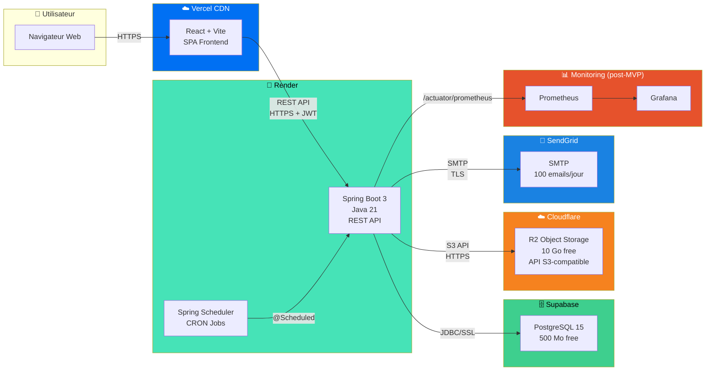
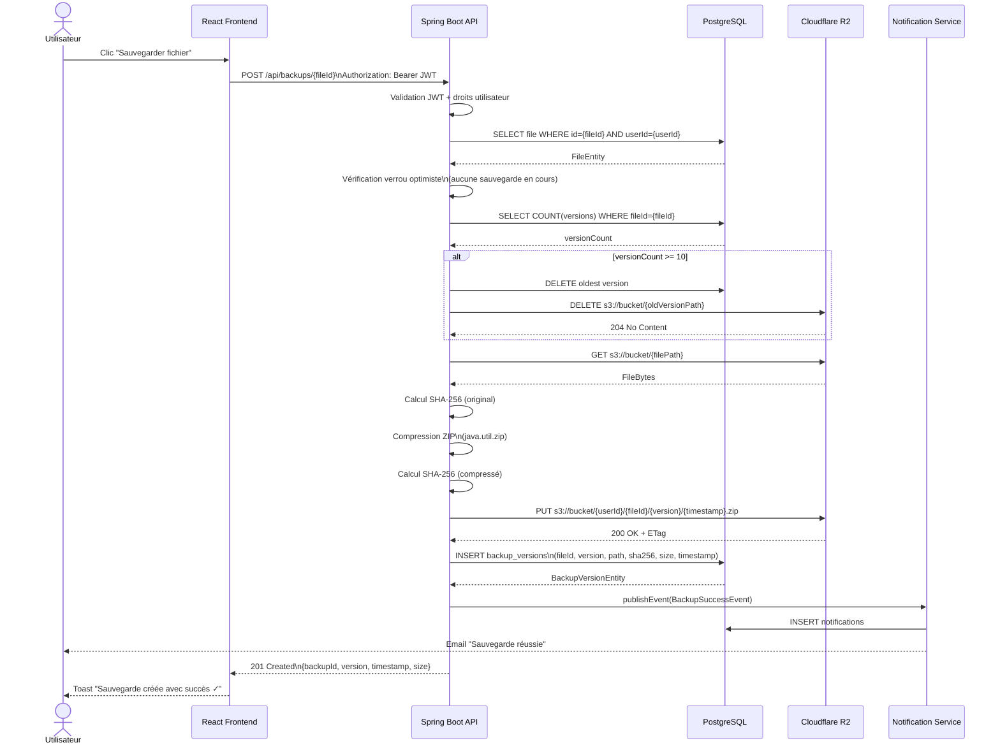
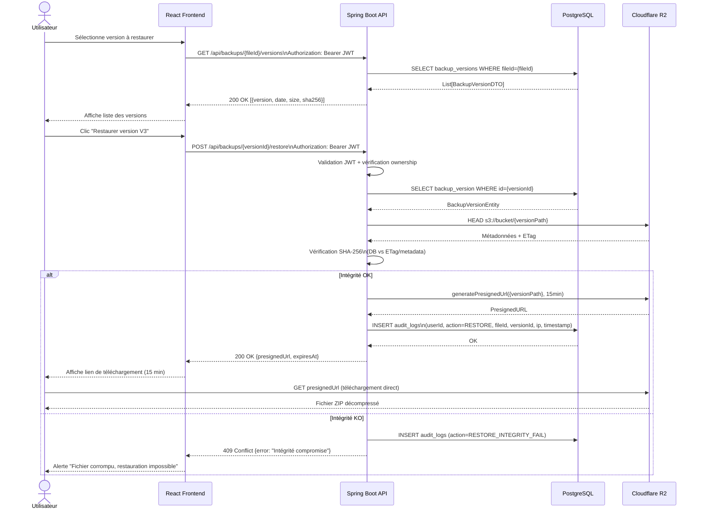

# SmartBackup — Phase 1 : Analyse & Architecture

> **Document de référence technique — Phase 1**  
> Équipe : SmartBackup | Rôle auteur : Software Architect  
> Date : Novembre 2026 | Version : 1.0.0

---

## Table des Matières

1. [Analyse Fonctionnelle Complète](#1-analyse-fonctionnelle-complète)
2. [Architecture Technique Détaillée](#2-architecture-technique-détaillée)
3. [Diagrammes Mermaid](#3-diagrammes-mermaid)
4. [Structure des Dossiers du Projet](#4-structure-des-dossiers-du-projet)
5. [Versions et Dépendances Recommandées](#5-versions-et-dépendances-recommandées)
6. [Tableau des Risques Techniques](#6-tableau-des-risques-techniques)
7. [Planning en 10 Phases](#7-planning-en-10-phases)
8. [Répartition des Tâches](#8-répartition-des-tâches)

---

## 1. Analyse Fonctionnelle Complète

### 1.1 Acteurs du Système

| Acteur | Description | Droits |
|--------|-------------|--------|
| **Utilisateur Anonyme** | Visiteur non authentifié sur l'application | Accès à la page d'accueil, inscription, connexion uniquement |
| **Utilisateur Authentifié** | Utilisateur connecté avec un compte valide | Gestion de ses fichiers, sauvegardes, restaurations, planifications |
| **Scheduler (Système)** | Composant interne Spring Scheduler / Quartz | Déclenche les sauvegardes planifiées automatiquement, sans interaction utilisateur |
| **Administrateur** *(post-MVP)* | Super-utilisateur avec accès système global | Supervision des métriques, gestion des quotas, maintenance |

---

### 1.2 Modules Fonctionnels (9 modules)

#### Module 1 — Authentification & Gestion des Comptes (AUTH)

**Description :** Gère l'inscription, la connexion, la déconnexion et la gestion du profil utilisateur.

**Règles Métier :**
- RB-AUTH-01 : Le mot de passe doit contenir au minimum 8 caractères, 1 majuscule, 1 chiffre, 1 caractère spécial.
- RB-AUTH-02 : Le token JWT a une durée de vie de 15 minutes (access token) + 7 jours (refresh token).
- RB-AUTH-03 : Après 5 tentatives échouées, le compte est verrouillé 15 minutes.
- RB-AUTH-04 : L'email doit être unique dans le système.
- RB-AUTH-05 : Un utilisateur ne peut pas créer de compte avec un email temporaire (vérification par liste de domaines).

**Cas d'utilisation :**
- UC-AUTH-01 : S'inscrire avec email/mot de passe
- UC-AUTH-02 : Se connecter
- UC-AUTH-03 : Se déconnecter
- UC-AUTH-04 : Rafraîchir le token JWT
- UC-AUTH-05 : Modifier son mot de passe
- UC-AUTH-06 : Supprimer son compte (soft delete)

---

#### Module 2 — Gestion des Fichiers & Métadonnées (FILE)

**Description :** Upload, listage, suppression et visualisation des métadonnées des fichiers sauvegardés.

**Règles Métier :**
- RB-FILE-01 : Taille maximale par fichier : 100 Mo (contrainte Cloudflare R2 free tier).
- RB-FILE-02 : Types autorisés : tous sauf `.exe`, `.bat`, `.sh`, `.dll` (sécurité).
- RB-FILE-03 : Le nom de fichier est sanitisé (suppression des caractères spéciaux dangereux).
- RB-FILE-04 : Chaque fichier est identifié par un UUID unique généré côté backend.
- RB-FILE-05 : Les métadonnées (nom original, taille, type MIME, hash SHA-256, date upload) sont stockées en base.
- RB-FILE-06 : Un utilisateur peut stocker au maximum 1 Go total (contrainte free tier).

**Cas d'utilisation :**
- UC-FILE-01 : Uploader un fichier
- UC-FILE-02 : Lister ses fichiers
- UC-FILE-03 : Télécharger un fichier
- UC-FILE-04 : Supprimer un fichier (logique + physique)
- UC-FILE-05 : Consulter les métadonnées d'un fichier

---

#### Module 3 — Sauvegarde Manuelle (BACKUP-MANUAL)

**Description :** Permet à l'utilisateur de déclencher une sauvegarde à la demande.

**Règles Métier :**
- RB-BKP-01 : Une sauvegarde crée un snapshot compressé (ZIP) du fichier source.
- RB-BKP-02 : Chaque sauvegarde est versionnée : un fichier peut avoir N versions.
- RB-BKP-03 : Le nombre maximum de versions par fichier est limité à 10 (rotation automatique).
- RB-BKP-04 : Une sauvegarde en cours bloque une seconde sauvegarde du même fichier (verrou optimiste).
- RB-BKP-05 : Le hash SHA-256 du fichier est vérifié avant et après compression.
- RB-BKP-06 : La sauvegarde est stockée dans Cloudflare R2 avec le chemin : `{userId}/{fileId}/{version}/{timestamp}.zip`.

**Cas d'utilisation :**
- UC-BKP-01 : Déclencher une sauvegarde manuelle d'un fichier
- UC-BKP-02 : Consulter l'historique des versions d'un fichier
- UC-BKP-03 : Comparer deux versions

---

#### Module 4 — Sauvegarde Planifiée / Automatique (BACKUP-AUTO)

**Description :** Planification de sauvegardes récurrentes par l'utilisateur, exécutées par le Scheduler.

**Règles Métier :**
- RB-SCHED-01 : Fréquences disponibles : Horaire, Quotidienne, Hebdomadaire, Mensuelle.
- RB-SCHED-02 : Un utilisateur peut créer au maximum 5 planifications actives simultanément (free tier).
- RB-SCHED-03 : Le Scheduler vérifie toutes les minutes les tâches à exécuter.
- RB-SCHED-04 : Si une sauvegarde planifiée échoue 3 fois consécutives, la planification est suspendue et l'utilisateur est notifié.
- RB-SCHED-05 : Les planifications sont stockées en base avec expression CRON.
- RB-SCHED-06 : Un journal d'exécution (succès/échec/durée) est conservé 30 jours.

**Cas d'utilisation :**
- UC-SCHED-01 : Créer une planification de sauvegarde
- UC-SCHED-02 : Modifier une planification
- UC-SCHED-03 : Suspendre/Reprendre une planification
- UC-SCHED-04 : Supprimer une planification
- UC-SCHED-05 : Consulter le journal d'exécution

---

#### Module 5 — Restauration (RESTORE)

**Description :** Permet de restaurer une version précédente d'un fichier.

**Règles Métier :**
- RB-REST-01 : La restauration génère une URL pré-signée Cloudflare R2 valable 15 minutes.
- RB-REST-02 : Le fichier restauré est téléchargeable directement depuis le navigateur.
- RB-REST-03 : L'intégrité du fichier restauré est vérifiée via le hash SHA-256 stocké en base.
- RB-REST-04 : Toute restauration est tracée dans le journal d'audit.
- RB-REST-05 : L'utilisateur peut choisir entre : télécharger la version ou l'écraser sur le stockage courant.

**Cas d'utilisation :**
- UC-REST-01 : Sélectionner une version à restaurer
- UC-REST-02 : Télécharger la version restaurée
- UC-REST-03 : Écraser la version courante par une version antérieure
- UC-REST-04 : Vérifier l'intégrité d'une sauvegarde

---

#### Module 6 — Tableau de Bord & Statistiques (DASHBOARD)

**Description :** Vue synthétique de l'activité de l'utilisateur.

**Règles Métier :**
- RB-DASH-01 : Le dashboard affiche : espace utilisé, nombre de fichiers, dernières sauvegardes, prochaines sauvegardes planifiées.
- RB-DASH-02 : Le quota d'espace est affiché en temps réel (calculé à chaque requête, mis en cache 5 min Redis/Map in-memory).
- RB-DASH-03 : Un graphique d'activité sur 30 jours est disponible.
- RB-DASH-04 : Les données sont paginées (20 éléments par page).

**Cas d'utilisation :**
- UC-DASH-01 : Consulter le tableau de bord
- UC-DASH-02 : Visualiser l'historique d'activité
- UC-DASH-03 : Exporter un rapport CSV des activités

---

#### Module 7 — Notifications & Alertes (NOTIF)

**Description :** Système de notification pour informer l'utilisateur des événements importants.

**Règles Métier :**
- RB-NOTIF-01 : Notifications par email (SMTP via SendGrid free tier : 100 emails/jour).
- RB-NOTIF-02 : Notifications in-app via Server-Sent Events (SSE) ou polling toutes les 30 secondes.
- RB-NOTIF-03 : Événements notifiés : sauvegarde réussie, sauvegarde échouée, quota 80% atteint, quota 100% atteint, planification suspendue.
- RB-NOTIF-04 : L'utilisateur peut configurer ses préférences de notification.
- RB-NOTIF-05 : Les notifications non lues sont affichées dans une icône cloche.

**Cas d'utilisation :**
- UC-NOTIF-01 : Recevoir une notification de sauvegarde réussie/échouée
- UC-NOTIF-02 : Consulter ses notifications in-app
- UC-NOTIF-03 : Marquer les notifications comme lues
- UC-NOTIF-04 : Configurer les préférences de notification

---

#### Module 8 — Gestion des Accès & Sécurité (SECURITY)

**Description :** Contrôle d'accès, chiffrement et audit de sécurité.

**Règles Métier :**
- RB-SEC-01 : Toutes les communications sont en HTTPS (TLS 1.3).
- RB-SEC-02 : Les fichiers sont chiffrés côté serveur dans R2 (SSE-C ou SSE-R2).
- RB-SEC-03 : Les clés API (R2, DB) sont stockées dans des variables d'environnement, jamais en dur.
- RB-SEC-04 : Un journal d'audit complet (qui, quoi, quand, IP) est conservé 90 jours.
- RB-SEC-05 : CORS configuré pour n'accepter que le domaine Vercel de production.
- RB-SEC-06 : Rate limiting : 100 requêtes/minute par IP (Spring Boot + Bucket4j).
- RB-SEC-07 : Headers de sécurité HTTP : HSTS, CSP, X-Frame-Options, X-Content-Type-Options.

**Cas d'utilisation :**
- UC-SEC-01 : Auditer les accès à ses fichiers
- UC-SEC-02 : Révoquer un token (déconnexion forcée)
- UC-SEC-03 : Consulter le journal d'activité de son compte

---

#### Module 9 — Administration & Monitoring (ADMIN)

**Description :** Supervision de la santé du système (post-MVP, Prometheus + Grafana).

**Règles Métier :**
- RB-ADMIN-01 : Endpoint `/actuator/health` exposé et sécurisé.
- RB-ADMIN-02 : Métriques JVM, HTTP, DB, R2 exposées via Micrometer → Prometheus.
- RB-ADMIN-03 : Alertes Grafana sur : latence > 2s, erreurs > 5%, espace DB > 400 Mo.
- RB-ADMIN-04 : Dashboard Grafana préconstruit avec les métriques clés.

**Cas d'utilisation :**
- UC-ADMIN-01 : Consulter les métriques système
- UC-ADMIN-02 : Visualiser les alertes actives
- UC-ADMIN-03 : Exporter les logs système

---

### 1.3 Exigences Fonctionnelles

| ID | Module | Exigence |
|----|--------|----------|
| EF-001 | AUTH | Le système doit permettre l'inscription par email/mot de passe |
| EF-002 | AUTH | Le système doit émettre un JWT (access + refresh) à la connexion |
| EF-003 | AUTH | Le système doit invalider le refresh token à la déconnexion |
| EF-004 | AUTH | Le système doit verrouiller un compte après 5 échecs consécutifs |
| EF-005 | AUTH | Le système doit permettre la suppression de compte (soft delete) |
| EF-006 | FILE | Le système doit permettre l'upload de fichiers jusqu'à 100 Mo |
| EF-007 | FILE | Le système doit calculer et stocker le hash SHA-256 de chaque fichier uploadé |
| EF-008 | FILE | Le système doit valider le type MIME du fichier avant acceptation |
| EF-009 | FILE | Le système doit lister les fichiers d'un utilisateur avec pagination |
| EF-010 | FILE | Le système doit permettre la suppression logique et physique d'un fichier |
| EF-011 | BACKUP-MANUAL | Le système doit créer un snapshot compressé ZIP d'un fichier à la demande |
| EF-012 | BACKUP-MANUAL | Le système doit versionner les sauvegardes (max 10 versions/fichier) |
| EF-013 | BACKUP-MANUAL | Le système doit stocker la sauvegarde dans Cloudflare R2 |
| EF-014 | BACKUP-MANUAL | Le système doit vérifier l'intégrité via SHA-256 après compression |
| EF-015 | BACKUP-AUTO | Le système doit permettre la création de planifications CRON |
| EF-016 | BACKUP-AUTO | Le scheduler doit exécuter les sauvegardes planifiées automatiquement |
| EF-017 | BACKUP-AUTO | Le système doit suspendre une planification après 3 échecs consécutifs |
| EF-018 | BACKUP-AUTO | Le système doit conserver un journal d'exécution 30 jours |
| EF-019 | RESTORE | Le système doit générer une URL pré-signée pour le téléchargement |
| EF-020 | RESTORE | Le système doit vérifier l'intégrité du fichier restauré |
| EF-021 | RESTORE | Le système doit permettre l'écrasement de la version courante |
| EF-022 | DASHBOARD | Le système doit afficher l'espace utilisé en temps réel |
| EF-023 | DASHBOARD | Le système doit afficher l'historique d'activité sur 30 jours |
| EF-024 | DASHBOARD | Le système doit permettre l'export CSV des activités |
| EF-025 | NOTIF | Le système doit envoyer un email lors d'une sauvegarde échouée |
| EF-026 | NOTIF | Le système doit afficher les notifications in-app non lues |
| EF-027 | NOTIF | Le système doit alerter à 80% et 100% du quota atteint |
| EF-028 | SECURITY | Le système doit logger toutes les actions dans un journal d'audit |
| EF-029 | SECURITY | Le système doit appliquer un rate limiting de 100 req/min par IP |
| EF-030 | ADMIN | Le système doit exposer des métriques Prometheus via `/actuator/prometheus` |

---

### 1.4 Exigences Non-Fonctionnelles

| Catégorie | ID | Exigence | Cible |
|-----------|-----|----------|-------|
| **Performance** | ENF-P-01 | Temps de réponse API (hors upload) | ≤ 500ms au P95 |
| **Performance** | ENF-P-02 | Throughput upload | ≥ 5 Mo/s |
| **Performance** | ENF-P-03 | Temps de chargement page (FCP) | ≤ 2s sur 4G |
| **Disponibilité** | ENF-D-01 | Uptime cible | ≥ 99% mensuel |
| **Disponibilité** | ENF-D-02 | Temps de réveil Render (cold start) | ≤ 30s toléré |
| **Disponibilité** | ENF-D-03 | MTTR en cas d'incident | ≤ 2h |
| **Sécurité** | ENF-S-01 | Chiffrement transit | TLS 1.3 obligatoire |
| **Sécurité** | ENF-S-02 | Chiffrement repos (R2) | SSE activé |
| **Sécurité** | ENF-S-03 | OWASP Top 10 | Couvert par design |
| **Sécurité** | ENF-S-04 | Scan de vulnérabilités | OWASP Dependency-Check en CI |
| **Scalabilité** | ENF-SC-01 | Architecture stateless | Horizontal scaling ready |
| **Scalabilité** | ENF-SC-02 | Connexions DB (pool) | HikariCP, max 10 connexions (Supabase free) |
| **Maintenabilité** | ENF-M-01 | Couverture de tests | ≥ 80% backend, ≥ 70% frontend |
| **Maintenabilité** | ENF-M-02 | Documentation API | OpenAPI 3.0 / Swagger UI |
| **Maintenabilité** | ENF-M-03 | Logs structurés | JSON via Logback + SLF4J |

---

## 2. Architecture Technique Détaillée

### 2.1 Vue d'Ensemble des 4 Couches

```
┌─────────────────────────────────────────────────────────────────┐
│  COUCHE 1 — FRONTEND (Vercel)                                    │
│  React 18 + Vite 5 + Tailwind CSS 3 + TypeScript                 │
│  ShadcnUI, React Query, Zustand, React Router v6                 │
└─────────────────────────────────────────────────────────────────┘
                            │ HTTPS / REST API
                            ▼
┌─────────────────────────────────────────────────────────────────┐
│  COUCHE 2 — BACKEND (Render)                                     │
│  Spring Boot 3.3 + Java 21 + Spring Security + Spring Scheduler  │
│  REST API, JWT Auth, Bucket4j Rate Limiting, Micrometer          │
└─────────────────────────────────────────────────────────────────┘
              │                              │
              ▼                              ▼
┌─────────────────────┐         ┌───────────────────────────────┐
│  COUCHE 3 — DATABASE │         │  COUCHE 4 — STORAGE            │
│  PostgreSQL 15        │         │  Cloudflare R2 (S3-compatible) │
│  Supabase (free tier) │         │  Fichiers compressés + chiffrés│
│  500 Mo max          │         │  10 Go free tier               │
└─────────────────────┘         └───────────────────────────────┘
```

---

### 2.2 Description des Couches

#### Couche 1 — Frontend (Vercel)

| Composant | Technologie | Rôle |
|-----------|-------------|------|
| Framework UI | React 18 + TypeScript | Composants réactifs, typage fort |
| Build Tool | Vite 5 | Build ultra-rapide, HMR |
| Styling | Tailwind CSS 3 | Utility-first, design system cohérent |
| Composants | ShadcnUI / Radix UI | Composants accessibles, non-opinionnés |
| State Management | Zustand | État global léger (auth, user) |
| Data Fetching | TanStack Query v5 | Cache, synchronisation, invalidation |
| Routing | React Router v6 | Navigation SPA avec routes protégées |
| Forms | React Hook Form + Zod | Validation côté client |
| HTTP Client | Axios | Intercepteurs JWT, gestion erreurs |
| Hébergement | Vercel | CDN global, déploiement automatique |

#### Couche 2 — Backend (Render)

| Composant | Technologie | Rôle |
|-----------|-------------|------|
| Framework | Spring Boot 3.3 | Auto-configuration, production-ready |
| Langage | Java 21 (LTS) | Virtual threads, records, pattern matching |
| Sécurité | Spring Security 6 + JJWT | Filtres JWT, RBAC |
| ORM | Spring Data JPA + Hibernate 6 | Mapping objet-relationnel |
| Scheduler | Spring Scheduler | Exécution des tâches planifiées CRON |
| Rate Limiting | Bucket4j | Token bucket algorithm par IP/user |
| Storage Client | AWS SDK v2 (S3 compatible) | Interaction avec Cloudflare R2 |
| Email | JavaMailSender + SendGrid SMTP | Notifications email |
| Monitoring | Micrometer + Spring Actuator | Métriques, health checks |
| Documentation | SpringDoc OpenAPI 3 | Swagger UI auto-généré |
| Validation | Bean Validation (Jakarta) | Validation des DTO entrants |
| Hébergement | Render (free tier) | Container Docker, 512 Mo RAM |

#### Couche 3 — Base de Données (Supabase/PostgreSQL)

| Élément | Détail |
|---------|--------|
| Moteur | PostgreSQL 15 |
| Hébergeur | Supabase (free: 500 Mo, 2 CPU partagés) |
| Connection Pooling | HikariCP (max 10 connexions) |
| Migrations | Flyway (versionned migrations) |
| Backups | Supabase daily backups (free tier) |
| SSL | Obligatoire (sslmode=require) |

**Tables principales :**
- `users` : Comptes utilisateurs
- `files` : Métadonnées des fichiers
- `backup_versions` : Versions des sauvegardes
- `backup_schedules` : Planifications CRON
- `schedule_executions` : Journal d'exécution des planifications
- `notifications` : Notifications in-app
- `audit_logs` : Journal d'audit
- `refresh_tokens` : Tokens de rafraîchissement JWT

#### Couche 4 — Stockage Objet (Cloudflare R2)

| Élément | Détail |
|---------|--------|
| Service | Cloudflare R2 |
| Compatibilité | API S3 (AWS SDK v2) |
| Free Tier | 10 Go stockage, 1 M opérations classe A/mois |
| Chemin fichier | `{userId}/{fileId}/{version}/{timestamp}.zip` |
| Chiffrement | SSE (Server-Side Encryption) |
| Accès | Clés d'accès + Secret via variables d'env |
| URL pré-signées | Valides 15 minutes pour restauration |

---

### 2.3 Flux de Données entre Composants

#### Flux Upload + Sauvegarde Manuelle

```
Utilisateur → [React App] → POST /api/files/upload → [Spring Boot]
                                                           │
                                              Validation MIME + Taille
                                                           │
                                              Calcul SHA-256
                                                           │
                                              Upload → [Cloudflare R2]
                                                           │
                                              INSERT → [PostgreSQL files]
                                                           │
                                              POST /api/backups → [Spring Boot]
                                                           │
                                              Compression ZIP
                                                           │
                                              Vérif SHA-256
                                                           │
                                              Store → [Cloudflare R2]
                                                           │
                                              INSERT → [PostgreSQL backup_versions]
                                                           │
                                              Notification → [Utilisateur]
```

#### Flux Restauration

```
Utilisateur → GET /api/backups/{id}/restore → [Spring Boot]
                                                    │
                                        Vérif droits (ownership)
                                                    │
                                        Vérif intégrité SHA-256
                                                    │
                                        Générer URL pré-signée R2 (15 min)
                                                    │
                                        INSERT → [PostgreSQL audit_logs]
                                                    │
                                        ← URL pré-signée [React App]
                                                    │
                                        Téléchargement direct [Cloudflare R2]
```

---

### 2.4 Décisions Architecturales Justifiées

| Décision | Choix Retenu | Alternatives | Justification |
|----------|-------------|--------------|---------------|
| **Auth** | JWT stateless (access 15min + refresh 7j) | Sessions serveur, OAuth2 | Stateless = scalable horizontalement, pas de session store needed. Refresh token en DB pour révocation. |
| **Storage** | Cloudflare R2 | AWS S3, GCS, MinIO | R2 = 0€ egress fees (contrairement à S3), 10 Go free tier, API S3-compatible → migration possible. |
| **DB** | PostgreSQL sur Supabase | MySQL, MongoDB, PlanetScale | PostgreSQL = ACID, relations complexes, Supabase = managed + free tier généreux + backups inclus. |
| **Backend** | Spring Boot 3 + Java 21 | Node.js/Express, FastAPI | Java 21 Virtual Threads = performance concurrence sans réactivité complexe. Spring ecosystem mature. |
| **Frontend** | React + Vite + Tailwind | Next.js, Angular, Vue | Vite = build ultra-rapide. React = écosystème large. Tailwind = design cohérent sans overhead CSS. |
| **Hébergement Backend** | Render | Railway, Fly.io, Heroku | Render free tier = 512 Mo RAM, Docker natif, SSL auto. Cold start acceptable (≤ 30s). |
| **Scheduler** | Spring Scheduler (CRON) | Quartz, cloud functions | Spring Scheduler suffisant pour MVP. Quartz si clustering nécessaire post-MVP. |
| **Rate Limiting** | Bucket4j in-process | Redis + rate limiter | Bucket4j = sans dépendance externe, suffisant pour instance unique free tier. |
| **API Style** | REST + JSON | GraphQL, gRPC | REST = standard, tooling abondant, compatible Swagger. GraphQL = surcoût pour ce niveau de complexité. |
| **State Frontend** | Zustand + TanStack Query | Redux, Recoil, SWR | Zustand = minimal boilerplate. TanStack Query = cache serveur déclaratif, invalidation fine. |
| **Compression** | ZIP (java.util.zip) | GZIP, LZ4, 7z | ZIP = standard universel, décompressable sans outil tiers, natif Java. |
| **Email** | SendGrid SMTP | SES, Mailgun, Resend | SendGrid free = 100 emails/jour, SMTP standard. Pas de dépendance SDK propriétaire. |

---

### 2.5 Patterns Architecturaux Utilisés

| Pattern | Localisation | Description |
|---------|-------------|-------------|
| **Repository Pattern** | Backend — couche persistence | Interface Spring Data JPA par entité. Abstraction de la couche DB. |
| **Service Layer** | Backend — couche métier | Services `@Service` encapsulant la logique métier. Transactionnalité `@Transactional`. |
| **DTO (Data Transfer Object)** | Backend — couche API | DTOs séparés pour Request/Response. Mappers manuels ou MapStruct. |
| **Factory Pattern** | Backend — BackupFactory | Création des objets BackupVersion avec calcul hash + chemin R2. |
| **Observer Pattern** | Backend — Notifications | ApplicationEventPublisher → NotificationEventListener. |
| **Strategy Pattern** | Backend — Compression | Interface CompressionStrategy, implémentation ZipCompressionStrategy. |
| **Decorator Pattern** | Backend — Rate Limiting | Bucket4j décore les endpoints via annotations `@RateLimit`. |
| **Custom Hooks** | Frontend — React | Hooks réutilisables : useAuth, useFiles, useBackups, useNotifications. |
| **Container / Presenter** | Frontend — React | Séparation logique (containers) et rendu (presentational components). |
| **Optimistic Updates** | Frontend — TanStack Query | UI mise à jour immédiatement, rollback si erreur serveur. |

---

## 3. Diagrammes Mermaid

### 3a. Diagramme d'Architecture Cloud



---

### 3b. Diagramme de Cas d'Utilisation

```mermaid
flowchart TD
    UA(["👤 Utilisateur\nAnonyme"])
    UAuth(["👤 Utilisateur\nAuthentifié"])
    SCHED(["⏰ Scheduler\nSystème"])

    subgraph AUTH["Module AUTH"]
        UC1["S'inscrire"]
        UC2["Se connecter"]
        UC3["Se déconnecter"]
        UC4["Modifier mot de passe"]
    end

    subgraph FILE["Module FILE"]
        UC5["Uploader un fichier"]
        UC6["Lister ses fichiers"]
        UC7["Supprimer un fichier"]
    end

    subgraph BACKUP["Module BACKUP"]
        UC8["Sauvegarde manuelle"]
        UC9["Créer planification"]
        UC10["Gérer planifications"]
        UC11["Exécuter sauvegarde auto"]
    end

    subgraph RESTORE["Module RESTORE"]
        UC12["Sélectionner version"]
        UC13["Télécharger version"]
        UC14["Écraser version courante"]
    end

    subgraph DASHBOARD["Module DASHBOARD"]
        UC15["Voir tableau de bord"]
        UC16["Exporter rapport CSV"]
    end

    subgraph NOTIF["Module NOTIF"]
        UC17["Consulter notifications"]
        UC18["Configurer alertes"]
    end

    UA --> UC1
    UA --> UC2
    UAuth --> UC3
    UAuth --> UC4
    UAuth --> UC5
    UAuth --> UC6
    UAuth --> UC7
    UAuth --> UC8
    UAuth --> UC9
    UAuth --> UC10
    UAuth --> UC12
    UAuth --> UC13
    UAuth --> UC14
    UAuth --> UC15
    UAuth --> UC16
    UAuth --> UC17
    UAuth --> UC18
    SCHED --> UC11

    style AUTH fill:#dbeafe
    style FILE fill:#dcfce7
    style BACKUP fill:#fef9c3
    style RESTORE fill:#fce7f3
    style DASHBOARD fill:#f3e8ff
    style NOTIF fill:#ffedd5
```



---

### 3c. Diagramme de Séquence — Sauvegarde Manuelle



---

### 3d. Diagramme de Séquence — Restauration



---

### 3e. Diagramme CI/CD Pipeline

```mermaid
flowchart LR
    subgraph DEV["👨‍💻 Développement"]
        PUSH["git push\nfeature branch"]
    end

    subgraph GHA["⚙️ GitHub Actions"]
        direction TB
        PR["Pull Request\nTrigger"]
        
        subgraph BACKEND_CI["Backend CI"]
            B1["☕ Setup Java 21"]
            B2["📦 Maven Cache"]
            B3["🧪 Tests Unitaires\n./mvnw test"]
            B4["🔍 OWASP Check\n./mvnw dependency-check"]
            B5["🏗️ Build JAR\n./mvnw package -DskipTests"]
            B6["🐳 Build Docker Image"]
            B7["📤 Push DockerHub"]
        end

        subgraph FRONTEND_CI["Frontend CI"]
            F1["📦 Setup Node 20\npnpm install"]
            F2["🧹 Lint\npnpm run lint"]
            F3["🧪 Tests\npnpm run test"]
            F4["🏗️ Build\npnpm run build"]
            F5["📤 Deploy Vercel Preview"]
        end

        subgraph MERGE["main branch"]
            M1["🔀 Merge PR"]
            M2["🚀 Deploy Backend\nRender (auto-deploy)"]
            M3["🚀 Deploy Frontend\nVercel (auto-deploy)"]
            M4["🩺 Health Check\nGET /actuator/health"]
            M5["✅ Notify Slack/Email"]
        end
    end

    PUSH --> PR
    PR --> B1
    B1 --> B2 --> B3 --> B4 --> B5 --> B6 --> B7
    PR --> F1
    F1 --> F2 --> F3 --> F4 --> F5

    B7 --> M1
    F5 --> M1
    M1 --> M2
    M1 --> M3
    M2 --> M4
    M3 --> M4
    M4 --> M5

    style GHA fill:#24292e,color:#fff
    style BACKEND_CI fill:#1e3a5f,color:#fff
    style FRONTEND_CI fill:#0f3460,color:#fff
    style MERGE fill:#1a5276,color:#fff
```



---

## 4. Structure des Dossiers du Projet

```
smartbackup/
├── 📁 .github/
│   └── 📁 workflows/
│       ├── backend-ci.yml          # CI/CD Backend (Java + Docker)
│       └── frontend-ci.yml         # CI/CD Frontend (Node + Vercel)
│
├── 📁 backend/                      # Spring Boot 3 + Java 21
│   ├── Dockerfile                   # Image Docker production
│   ├── docker-compose.yml           # Dev local (app + postgres + pgadmin)
│   ├── pom.xml                      # Dépendances Maven
│   └── 📁 src/
│       ├── 📁 main/
│       │   ├── 📁 java/com/smartbackup/
│       │   │   ├── SmartBackupApplication.java       # Point d'entrée
│       │   │   ├── 📁 config/
│       │   │   │   ├── SecurityConfig.java           # Spring Security + JWT
│       │   │   │   ├── CorsConfig.java               # CORS (Vercel domain)
│       │   │   │   ├── S3Config.java                 # Cloudflare R2 client
│       │   │   │   ├── RateLimitConfig.java          # Bucket4j config
│       │   │   │   └── OpenApiConfig.java            # Swagger UI config
│       │   │   ├── 📁 controller/
│       │   │   │   ├── AuthController.java           # /api/auth/**
│       │   │   │   ├── FileController.java           # /api/files/**
│       │   │   │   ├── BackupController.java         # /api/backups/**
│       │   │   │   ├── RestoreController.java        # /api/restore/**
│       │   │   │   ├── ScheduleController.java       # /api/schedules/**
│       │   │   │   ├── DashboardController.java      # /api/dashboard/**
│       │   │   │   └── NotificationController.java   # /api/notifications/**
│       │   │   ├── 📁 service/
│       │   │   │   ├── AuthService.java
│       │   │   │   ├── FileService.java
│       │   │   │   ├── BackupService.java
│       │   │   │   ├── RestoreService.java
│       │   │   │   ├── ScheduleService.java
│       │   │   │   ├── StorageService.java           # Abstraction R2/S3
│       │   │   │   ├── CompressionService.java       # ZIP compression
│       │   │   │   ├── NotificationService.java
│       │   │   │   ├── EmailService.java
│       │   │   │   └── AuditService.java
│       │   │   ├── 📁 repository/
│       │   │   │   ├── UserRepository.java
│       │   │   │   ├── FileRepository.java
│       │   │   │   ├── BackupVersionRepository.java
│       │   │   │   ├── ScheduleRepository.java
│       │   │   │   ├── ScheduleExecutionRepository.java
│       │   │   │   ├── NotificationRepository.java
│       │   │   │   ├── AuditLogRepository.java
│       │   │   │   └── RefreshTokenRepository.java
│       │   │   ├── 📁 entity/
│       │   │   │   ├── User.java
│       │   │   │   ├── FileEntity.java
│       │   │   │   ├── BackupVersion.java
│       │   │   │   ├── BackupSchedule.java
│       │   │   │   ├── ScheduleExecution.java
│       │   │   │   ├── Notification.java
│       │   │   │   ├── AuditLog.java
│       │   │   │   └── RefreshToken.java
│       │   │   ├── 📁 dto/
│       │   │   │   ├── 📁 request/
│       │   │   │   │   ├── RegisterRequest.java
│       │   │   │   │   ├── LoginRequest.java
│       │   │   │   │   ├── CreateScheduleRequest.java
│       │   │   │   │   └── ChangePasswordRequest.java
│       │   │   │   └── 📁 response/
│       │   │   │       ├── AuthResponse.java
│       │   │   │       ├── FileResponse.java
│       │   │   │       ├── BackupVersionResponse.java
│       │   │   │       ├── DashboardResponse.java
│       │   │   │       └── ApiErrorResponse.java
│       │   │   ├── 📁 security/
│       │   │   │   ├── JwtTokenProvider.java         # Génération/validation JWT
│       │   │   │   ├── JwtAuthenticationFilter.java  # Filtre HTTP JWT
│       │   │   │   └── UserDetailsServiceImpl.java
│       │   │   ├── 📁 scheduler/
│       │   │   │   └── BackupSchedulerJob.java       # @Scheduled CRON executor
│       │   │   ├── 📁 event/
│       │   │   │   ├── BackupSuccessEvent.java
│       │   │   │   ├── BackupFailureEvent.java
│       │   │   │   └── NotificationEventListener.java
│       │   │   ├── 📁 exception/
│       │   │   │   ├── GlobalExceptionHandler.java   # @RestControllerAdvice
│       │   │   │   ├── FileNotFoundException.java
│       │   │   │   ├── BackupLockException.java
│       │   │   │   ├── QuotaExceededException.java
│       │   │   │   └── IntegrityCheckException.java
│       │   │   └── 📁 util/
│       │   │       ├── HashUtil.java                 # SHA-256 calculator
│       │   │       ├── FilePathUtil.java             # R2 path builder
│       │   │       └── PageableUtil.java
│       │   └── 📁 resources/
│       │       ├── application.yml                   # Config principale
│       │       ├── application-dev.yml               # Config dev local
│       │       ├── application-prod.yml              # Config production
│       │       ├── logback-spring.xml                # Logs JSON structurés
│       │       └── 📁 db/migration/                  # Flyway migrations
│       │           ├── V1__create_users.sql
│       │           ├── V2__create_files.sql
│       │           ├── V3__create_backup_versions.sql
│       │           ├── V4__create_schedules.sql
│       │           ├── V5__create_notifications.sql
│       │           ├── V6__create_audit_logs.sql
│       │           └── V7__create_refresh_tokens.sql
│       └── 📁 test/
│           └── 📁 java/com/smartbackup/
│               ├── 📁 service/                       # Tests unitaires services
│               ├── 📁 controller/                    # Tests intégration API
│               └── 📁 repository/                    # Tests repository (H2)
│
├── 📁 frontend/                     # React + Vite + Tailwind
│   ├── package.json
│   ├── vite.config.ts
│   ├── tailwind.config.ts
│   ├── tsconfig.json
│   ├── .env.example                 # Variables d'env (VITE_API_URL)
│   ├── index.html
│   └── 📁 src/
│       ├── main.tsx                 # Point d'entrée React
│       ├── App.tsx                  # Router + Providers
│       ├── 📁 components/
│       │   ├── 📁 ui/               # ShadcnUI components (Button, Input, etc.)
│       │   ├── 📁 layout/
│       │   │   ├── Navbar.tsx
│       │   │   ├── Sidebar.tsx
│       │   │   └── Footer.tsx
│       │   ├── 📁 auth/
│       │   │   ├── LoginForm.tsx
│       │   │   └── RegisterForm.tsx
│       │   ├── 📁 files/
│       │   │   ├── FileUploader.tsx       # Drag & drop upload
│       │   │   ├── FileList.tsx
│       │   │   ├── FileCard.tsx
│       │   │   └── FileMetadata.tsx
│       │   ├── 📁 backups/
│       │   │   ├── BackupHistory.tsx
│       │   │   ├── BackupVersionList.tsx
│       │   │   └── ManualBackupButton.tsx
│       │   ├── 📁 schedules/
│       │   │   ├── ScheduleForm.tsx
│       │   │   └── ScheduleList.tsx
│       │   ├── 📁 dashboard/
│       │   │   ├── StorageQuotaBar.tsx
│       │   │   ├── ActivityChart.tsx
│       │   │   └── RecentBackups.tsx
│       │   └── 📁 notifications/
│       │       ├── NotificationBell.tsx
│       │       └── NotificationList.tsx
│       ├── 📁 pages/
│       │   ├── HomePage.tsx
│       │   ├── LoginPage.tsx
│       │   ├── RegisterPage.tsx
│       │   ├── DashboardPage.tsx
│       │   ├── FilesPage.tsx
│       │   ├── BackupHistoryPage.tsx
│       │   ├── SchedulesPage.tsx
│       │   ├── RestorePage.tsx
│       │   └── ProfilePage.tsx
│       ├── 📁 hooks/
│       │   ├── useAuth.ts
│       │   ├── useFiles.ts
│       │   ├── useBackups.ts
│       │   ├── useSchedules.ts
│       │   ├── useDashboard.ts
│       │   └── useNotifications.ts
│       ├── 📁 store/
│       │   ├── authStore.ts          # Zustand: user, tokens
│       │   └── notificationStore.ts  # Zustand: notifications non lues
│       ├── 📁 api/
│       │   ├── axiosInstance.ts      # Axios + intercepteurs JWT
│       │   ├── authApi.ts
│       │   ├── fileApi.ts
│       │   ├── backupApi.ts
│       │   ├── scheduleApi.ts
│       │   └── dashboardApi.ts
│       ├── 📁 types/
│       │   ├── auth.types.ts
│       │   ├── file.types.ts
│       │   ├── backup.types.ts
│       │   └── common.types.ts
│       └── 📁 utils/
│           ├── formatBytes.ts
│           ├── formatDate.ts
│           └── validators.ts
│
├── 📁 docs/
│   ├── PHASE1_ARCHITECTURE.md       # Ce document
│   ├── API_SPEC.md                  # Spécification OpenAPI (à générer)
│   └── DB_SCHEMA.md                 # Schéma de base de données
│
└── README.md                        # Documentation projet principale
```

---

## 5. Versions et Dépendances Recommandées

### 5.1 Backend — `pom.xml`

```xml
<?xml version="1.0" encoding="UTF-8"?>
<project xmlns="http://maven.apache.org/POM/4.0.0"
         xmlns:xsi="http://www.w3.org/2001/XMLSchema-instance"
         xsi:schemaLocation="http://maven.apache.org/POM/4.0.0
         https://maven.apache.org/xsd/maven-4.0.0.xsd">
    <modelVersion>4.0.0</modelVersion>

    <parent>
        <groupId>org.springframework.boot</groupId>
        <artifactId>spring-boot-starter-parent</artifactId>
        <version>3.3.5</version>
        <relativePath/>
    </parent>

    <groupId>com.smartbackup</groupId>
    <artifactId>smartbackup-backend</artifactId>
    <version>0.1.0-SNAPSHOT</version>
    <name>smartbackup</name>
    <description>SmartBackup Cloud Backup Application</description>

    <properties>
        <java.version>21</java.version>
        <jjwt.version>0.12.6</jjwt.version>
        <bucket4j.version>8.10.1</bucket4j.version>
        <springdoc.version>2.6.0</springdoc.version>
        <aws.sdk.version>2.28.21</aws.sdk.version>
        <mapstruct.version>1.6.2</mapstruct.version>
        <owasp.plugin.version>10.0.4</owasp.plugin.version>
    </properties>

    <dependencies>

        <!-- ===== SPRING BOOT CORE ===== -->
        <dependency>
            <groupId>org.springframework.boot</groupId>
            <artifactId>spring-boot-starter-web</artifactId>
        </dependency>
        <dependency>
            <groupId>org.springframework.boot</groupId>
            <artifactId>spring-boot-starter-security</artifactId>
        </dependency>
        <dependency>
            <groupId>org.springframework.boot</groupId>
            <artifactId>spring-boot-starter-data-jpa</artifactId>
        </dependency>
        <dependency>
            <groupId>org.springframework.boot</groupId>
            <artifactId>spring-boot-starter-validation</artifactId>
        </dependency>
        <dependency>
            <groupId>org.springframework.boot</groupId>
            <artifactId>spring-boot-starter-actuator</artifactId>
        </dependency>
        <dependency>
            <groupId>org.springframework.boot</groupId>
            <artifactId>spring-boot-starter-mail</artifactId>
        </dependency>

        <!-- ===== DATABASE ===== -->
        <dependency>
            <groupId>org.postgresql</groupId>
            <artifactId>postgresql</artifactId>
            <version>42.7.4</version>
            <scope>runtime</scope>
        </dependency>
        <dependency>
            <groupId>org.flywaydb</groupId>
            <artifactId>flyway-core</artifactId>
            <version>10.19.0</version>
        </dependency>
        <dependency>
            <groupId>org.flywaydb</groupId>
            <artifactId>flyway-database-postgresql</artifactId>
            <version>10.19.0</version>
        </dependency>

        <!-- ===== JWT ===== -->
        <dependency>
            <groupId>io.jsonwebtoken</groupId>
            <artifactId>jjwt-api</artifactId>
            <version>${jjwt.version}</version>
        </dependency>
        <dependency>
            <groupId>io.jsonwebtoken</groupId>
            <artifactId>jjwt-impl</artifactId>
            <version>${jjwt.version}</version>
            <scope>runtime</scope>
        </dependency>
        <dependency>
            <groupId>io.jsonwebtoken</groupId>
            <artifactId>jjwt-jackson</artifactId>
            <version>${jjwt.version}</version>
            <scope>runtime</scope>
        </dependency>

        <!-- ===== AWS SDK v2 (Cloudflare R2 / S3-compatible) ===== -->
        <dependency>
            <groupId>software.amazon.awssdk</groupId>
            <artifactId>s3</artifactId>
            <version>${aws.sdk.version}</version>
        </dependency>
        <dependency>
            <groupId>software.amazon.awssdk</groupId>
            <artifactId>netty-nio-client</artifactId>
            <version>${aws.sdk.version}</version>
        </dependency>

        <!-- ===== RATE LIMITING ===== -->
        <dependency>
            <groupId>com.github.vladimir-bukhtoyarov</groupId>
            <artifactId>bucket4j-core</artifactId>
            <version>${bucket4j.version}</version>
        </dependency>

        <!-- ===== DOCUMENTATION API ===== -->
        <dependency>
            <groupId>org.springdoc</groupId>
            <artifactId>springdoc-openapi-starter-webmvc-ui</artifactId>
            <version>${springdoc.version}</version>
        </dependency>

        <!-- ===== MAPPING ===== -->
        <dependency>
            <groupId>org.mapstruct</groupId>
            <artifactId>mapstruct</artifactId>
            <version>${mapstruct.version}</version>
        </dependency>

        <!-- ===== MONITORING ===== -->
        <dependency>
            <groupId>io.micrometer</groupId>
            <artifactId>micrometer-registry-prometheus</artifactId>
            <scope>runtime</scope>
        </dependency>

        <!-- ===== UTILS ===== -->
        <dependency>
            <groupId>org.projectlombok</groupId>
            <artifactId>lombok</artifactId>
            <optional>true</optional>
        </dependency>
        <dependency>
            <groupId>com.google.guava</groupId>
            <artifactId>guava</artifactId>
            <version>33.3.1-jre</version>
        </dependency>

        <!-- ===== TESTS ===== -->
        <dependency>
            <groupId>org.springframework.boot</groupId>
            <artifactId>spring-boot-starter-test</artifactId>
            <scope>test</scope>
        </dependency>
        <dependency>
            <groupId>org.springframework.security</groupId>
            <artifactId>spring-security-test</artifactId>
            <scope>test</scope>
        </dependency>
        <dependency>
            <groupId>com.h2database</groupId>
            <artifactId>h2</artifactId>
            <scope>test</scope>
        </dependency>
        <dependency>
            <groupId>org.testcontainers</groupId>
            <artifactId>postgresql</artifactId>
            <version>1.20.3</version>
            <scope>test</scope>
        </dependency>
        <dependency>
            <groupId>org.testcontainers</groupId>
            <artifactId>junit-jupiter</artifactId>
            <version>1.20.3</version>
            <scope>test</scope>
        </dependency>

    </dependencies>

    <build>
        <plugins>
            <plugin>
                <groupId>org.springframework.boot</groupId>
                <artifactId>spring-boot-maven-plugin</artifactId>
                <configuration>
                    <excludes>
                        <exclude>
                            <groupId>org.projectlombok</groupId>
                            <artifactId>lombok</artifactId>
                        </exclude>
                    </excludes>
                </configuration>
            </plugin>
            <!-- MapStruct annotation processor -->
            <plugin>
                <groupId>org.apache.maven.plugins</groupId>
                <artifactId>maven-compiler-plugin</artifactId>
                <configuration>
                    <annotationProcessorPaths>
                        <path>
                            <groupId>org.projectlombok</groupId>
                            <artifactId>lombok</artifactId>
                        </path>
                        <path>
                            <groupId>org.mapstruct</groupId>
                            <artifactId>mapstruct-processor</artifactId>
                            <version>${mapstruct.version}</version>
                        </path>
                    </annotationProcessorPaths>
                </configuration>
            </plugin>
            <!-- OWASP Dependency Check -->
            <plugin>
                <groupId>org.owasp</groupId>
                <artifactId>dependency-check-maven</artifactId>
                <version>${owasp.plugin.version}</version>
                <executions>
                    <execution>
                        <goals>
                            <goal>check</goal>
                        </goals>
                    </execution>
                </executions>
            </plugin>
        </plugins>
    </build>

</project>
```

---

### 5.2 Frontend — `package.json`

```json
{
  "name": "smartbackup-frontend",
  "version": "0.1.0",
  "private": true,
  "type": "module",
  "scripts": {
    "dev": "vite",
    "build": "tsc && vite build",
    "preview": "vite preview",
    "lint": "eslint . --ext ts,tsx --report-unused-disable-directives --max-warnings 0",
    "lint:fix": "eslint . --ext ts,tsx --fix",
    "test": "vitest",
    "test:ui": "vitest --ui",
    "test:coverage": "vitest run --coverage",
    "type-check": "tsc --noEmit"
  },
  "dependencies": {
    "react": "^18.3.1",
    "react-dom": "^18.3.1",
    "react-router-dom": "^6.27.0",
    "@tanstack/react-query": "^5.59.20",
    "@tanstack/react-query-devtools": "^5.59.20",
    "axios": "^1.7.7",
    "zustand": "^5.0.1",
    "react-hook-form": "^7.53.2",
    "zod": "^3.23.8",
    "@hookform/resolvers": "^3.9.1",
    "lucide-react": "^0.456.0",
    "@radix-ui/react-dialog": "^1.1.2",
    "@radix-ui/react-dropdown-menu": "^2.1.2",
    "@radix-ui/react-toast": "^1.2.2",
    "@radix-ui/react-progress": "^1.1.0",
    "@radix-ui/react-select": "^2.1.2",
    "@radix-ui/react-switch": "^1.1.1",
    "@radix-ui/react-tabs": "^1.1.1",
    "@radix-ui/react-tooltip": "^1.1.3",
    "@radix-ui/react-avatar": "^1.1.1",
    "@radix-ui/react-separator": "^1.1.0",
    "class-variance-authority": "^0.7.0",
    "clsx": "^2.1.1",
    "tailwind-merge": "^2.5.4",
    "recharts": "^2.13.3",
    "react-dropzone": "^14.3.5",
    "date-fns": "^4.1.0",
    "jwt-decode": "^4.0.0"
  },
  "devDependencies": {
    "@types/react": "^18.3.12",
    "@types/react-dom": "^18.3.1",
    "@types/node": "^22.9.0",
    "typescript": "^5.6.3",
    "vite": "^5.4.11",
    "@vitejs/plugin-react": "^4.3.3",
    "tailwindcss": "^3.4.14",
    "autoprefixer": "^10.4.20",
    "postcss": "^8.4.47",
    "@tailwindcss/forms": "^0.5.9",
    "@tailwindcss/typography": "^0.5.15",
    "eslint": "^9.14.0",
    "@typescript-eslint/eslint-plugin": "^8.13.0",
    "@typescript-eslint/parser": "^8.13.0",
    "eslint-plugin-react-hooks": "^5.0.0",
    "eslint-plugin-react-refresh": "^0.4.14",
    "vitest": "^2.1.4",
    "@vitest/ui": "^2.1.4",
    "@vitest/coverage-v8": "^2.1.4",
    "@testing-library/react": "^16.0.1",
    "@testing-library/user-event": "^14.5.2",
    "@testing-library/jest-dom": "^6.6.3",
    "msw": "^2.6.4"
  }
}
```

---

## 6. Tableau des Risques Techniques

| # | Risque | Probabilité | Impact | Criticité | Stratégie de Mitigation |
|---|--------|-------------|--------|-----------|------------------------|
| R-01 | **Mise en veille Render (cold start)** — L'instance gratuite s'arrête après 15 min d'inactivité, cold start ~30s | 🔴 Haute | 🟡 Moyen | **Élevée** | Implémenter un "keepalive" via GitHub Actions cron (GET /actuator/health toutes les 10 min). Afficher un spinner "réveil du serveur" côté frontend. |
| R-02 | **OOM Spring Boot (512 Mo RAM)** — Heap JVM + GC + threads peuvent dépasser 512 Mo | 🟡 Moyenne | 🔴 Élevé | **Élevée** | JVM flags: `-Xmx384m -Xms128m -XX:+UseG1GC`. Virtual Threads Java 21. HikariCP max 10 connexions. Dockerfile: `JAVA_OPTS=-XX:MaxRAMPercentage=75`. |
| R-03 | **Limites free tier Supabase (500 Mo)** — Logs d'audit et journal d'exécution croissants | 🟡 Moyenne | 🟡 Moyen | **Moyenne** | Jobs de purge schedulés (logs > 90 jours, executions > 30 jours). Index PostgreSQL pour requêtes rapides. Monitoring de l'espace DB via alerte Grafana > 400 Mo. |
| R-04 | **Clés API exposées** — Cloudflare R2 Access Key / Secret dans le code ou logs | 🟢 Faible | 🔴 Élevé | **Élevée** | Variables d'environnement uniquement (jamais en dur). GitHub Secrets pour CI/CD. Rotation trimestrielle des clés. Scan OWASP en CI. `.gitignore` strict sur `.env*`. |
| R-05 | **Corruption de données** — Échec partiel upload → métadonnées en DB sans fichier R2 | 🟡 Moyenne | 🔴 Élevé | **Élevée** | Pattern Saga compensatoire : si upload R2 échoue → rollback INSERT DB. Vérification SHA-256 post-upload systématique. Transaction DB uniquement après succès R2. |
| R-06 | **Concurrence sauvegardes** — Deux sauvegardes simultanées du même fichier → état incohérent | 🟡 Moyenne | 🟡 Moyen | **Moyenne** | Verrou optimiste (version field sur FileEntity). Lock applicatif in-memory (ConcurrentHashMap<fileId, ReentrantLock>). Réponse 409 Conflict si déjà en cours. |
| R-07 | **Limites free tier Cloudflare R2** — 10 Go stockage, 1M opérations/mois | 🟢 Faible | 🟡 Moyen | **Faible** | Quota 1 Go par utilisateur. Max 10 versions par fichier (rotation). Compression ZIP systématique. Dashboard quota visible. Alerte à 80% et 100%. |
| R-08 | **Expiration tokens JWT non gérée** — Race condition refresh / accès concurrent | 🟢 Faible | 🟡 Moyen | **Faible** | Intercepteur Axios : refresh automatique si 401. Queue des requêtes pendant le refresh. Logout forcé si refresh token expiré. |
| R-09 | **Perte de données Supabase free tier** — Projet suspendu après 1 semaine d'inactivité | 🔴 Haute | 🔴 Élevé | **Critique** | Scheduler keepalive DB (requête SELECT 1 toutes les 3 jours). Vérification activité régulière. Export DB mensuel via pg_dump. |
| R-10 | **Dépassement quota SendGrid (100 emails/jour)** — Burst de notifications | 🟢 Faible | 🟢 Faible | **Faible** | Rate limiting des notifications email (1 email/event max, groupage). Préférer notifications in-app. Throttle : max 5 emails/utilisateur/jour. |

---

## 7. Planning en 10 Phases

| Phase | Nom | Contenu | Durée estimée | Semaine |
|-------|-----|---------|---------------|---------|
| **Phase 0** | Initialisation & Setup | Création repos GitHub, setup projets (Spring Initializr + Vite), configuration CI/CD de base, déploiement "Hello World" sur Render + Vercel, connexion Supabase + R2 | **3 jours** | S1 |
| **Phase 1** | Architecture & Conception | Ce document PHASE1_ARCHITECTURE.md, schéma DB Flyway, maquettes UI Figma/Excalidraw, spécification API OpenAPI | **3 jours** | S1 |
| **Phase 2** | Authentification | Backend: Register/Login/Logout/Refresh JWT + Spring Security. Frontend: pages Login/Register, Zustand auth store, intercepteurs Axios, routes protégées | **5 jours** | S2 |
| **Phase 3** | Gestion des Fichiers | Backend: upload multipart, stockage R2, métadonnées DB, liste paginée, suppression. Frontend: FileUploader drag & drop, FileList, pagination | **5 jours** | S2-S3 |
| **Phase 4** | Sauvegarde Manuelle | Backend: service compression ZIP, versioning, rotation 10 versions, vérification SHA-256. Frontend: bouton sauvegarde, historique versions | **4 jours** | S3 |
| **Phase 5** | Restauration | Backend: génération URL pré-signée R2, vérification intégrité, audit log. Frontend: sélection version, téléchargement, écrasement | **3 jours** | S3-S4 |
| **Phase 6** | Sauvegardes Planifiées | Backend: CRUD planifications CRON, BackupSchedulerJob, journal exécution, suspension auto. Frontend: ScheduleForm, ScheduleList, journal | **5 jours** | S4 |
| **Phase 7** | Dashboard & Notifications | Backend: dashboard stats endpoint, NotificationService, SSE/polling, email SendGrid. Frontend: StorageQuotaBar, ActivityChart, NotificationBell | **4 jours** | S4-S5 |
| **Phase 8** | Sécurité & Hardening | Rate limiting Bucket4j, headers sécurité, audit log complet, OWASP scan CI, review CORS, tests de charge | **3 jours** | S5 |
| **Phase 9** | Tests & Documentation | Couverture ≥ 80% backend (JUnit 5 + Mockito + Testcontainers), ≥ 70% frontend (Vitest + RTL), documentation OpenAPI complète, README | **4 jours** | S5-S6 |
| **Phase 10** | Monitoring & MVP Release | Prometheus + Grafana setup (post-MVP), dashboards, alertes, UAT, bug fixes, release v1.0.0 | **3 jours** | S6 |
| | | **TOTAL** | **~42 jours** | **6 semaines** |

> [!NOTE]
> Planning basé sur 2 développeurs à mi-temps (env. 4-5h/jour). Un binôme à temps plein peut compresser à 3-4 semaines.

---

## 8. Répartition des Tâches

### Membre 1 — Frontend Developer (React + Vite + Tailwind)

| Phase | Tâches | Livrables |
|-------|--------|-----------|
| **Phase 0** | Setup projet Vite + React + Tailwind, config ESLint/Prettier, déploiement Vercel | Projet frontend déployé sur Vercel |
| **Phase 1** | Maquettes UI (Excalidraw), design system Tailwind, composants ShadcnUI base | Maquettes validées, composants UI de base |
| **Phase 2** | Pages Login/Register avec React Hook Form + Zod, Zustand auth store, intercepteurs Axios JWT, routes protégées React Router | Auth frontend complet |
| **Phase 3** | FileUploader (react-dropzone), FileList paginée, FileCard avec métadonnées, appels API fileApi.ts | Module fichiers frontend |
| **Phase 4** | ManualBackupButton, BackupHistory, BackupVersionList, intégration TanStack Query | Module sauvegarde manuelle frontend |
| **Phase 5** | RestorePage, sélection version, téléchargement via URL pré-signée, messages d'erreur intégrité | Module restauration frontend |
| **Phase 6** | ScheduleForm (créer/modifier), ScheduleList, toggle actif/inactif, journal d'exécution | Module planifications frontend |
| **Phase 7** | DashboardPage (StorageQuotaBar, ActivityChart recharts), NotificationBell, polling notifications | Dashboard + notifications frontend |
| **Phase 8** | Gestion erreurs globale (toast), skeleton loaders, responsive mobile, tests accessibilité | UX hardening |
| **Phase 9** | Tests Vitest + RTL (≥ 70% couverture), tests composants critiques (auth, upload, backup) | Suite de tests frontend |
| **Phase 10** | UAT, corrections bugs UI, optimisations (lazy loading, bundle size < 300 Ko) | Release v1.0.0 frontend |

---

### Membre 2 — Backend Developer (Spring Boot + Java 21)

| Phase | Tâches | Livrables |
|-------|--------|-----------|
| **Phase 0** | Spring Initializr, config application.yml (dev/prod), Dockerfile, docker-compose.yml local, déploiement Render | Backend déployé sur Render avec PostgreSQL Supabase |
| **Phase 1** | Schéma DB (7 migrations Flyway), entités JPA, configuration S3Config (R2), documentation architecture | Migrations V1-V7 validées, schéma DB |
| **Phase 2** | AuthController + AuthService, JwtTokenProvider, JwtAuthFilter, UserDetailsServiceImpl, RefreshToken flow, GlobalExceptionHandler auth | API Auth complète (register/login/logout/refresh) |
| **Phase 3** | FileController + FileService, upload multipart, stockage R2 (StorageService), calcul SHA-256, liste paginée, suppression logique+physique | API Files complète |
| **Phase 4** | BackupController + BackupService, compression ZIP (CompressionService), versioning, rotation 10 versions, verrou optimiste | API Sauvegarde manuelle |
| **Phase 5** | RestoreController + RestoreService, URL pré-signée R2 (15 min), vérification SHA-256, AuditService | API Restauration + audit |
| **Phase 6** | ScheduleController + ScheduleService, BackupSchedulerJob (@Scheduled CRON), ScheduleExecutionRepository, suspension auto 3 échecs | API Planifications + scheduler |
| **Phase 7** | DashboardController (stats agrégées), NotificationService, EventPublisher, EmailService (SendGrid SMTP), SSE endpoint | API Dashboard + notifications |
| **Phase 8** | Bucket4j rate limiting, headers sécurité (CorsConfig, HSTS), review OWASP, job purge logs, JVM tuning (Dockerfile) | Backend sécurisé et optimisé |
| **Phase 9** | Tests JUnit 5 + Mockito (≥ 80% services), tests intégration (Testcontainers PostgreSQL), Swagger UI complet | Suite tests backend + documentation API |
| **Phase 10** | Spring Actuator + Micrometer + Prometheus, dashboard Grafana préconstruit, alertes, release v1.0.0 | Monitoring opérationnel |

---

### Collaboration & Interfaces Partagées

| Point de Collaboration | Responsable | Consommateur | Contrat |
|------------------------|-------------|--------------|---------|
| Spécification REST API | Backend | Frontend | OpenAPI 3.0 dans `/docs/API_SPEC.md` |
| Modèles TypeScript | Backend (types) | Frontend | Types générés depuis DTOs Java |
| Variables d'environnement | Backend (nommage) | Frontend (VITE_*) | `.env.example` documenté |
| Gestion des erreurs HTTP | Backend (codes + messages) | Frontend (intercepteurs) | Format `ApiErrorResponse` standardisé |
| Format JWT (claims) | Backend | Frontend (jwt-decode) | Documenté dans `AuthResponse` |

---

> [!IMPORTANT]
> **Contraintes Free Tier à Surveiller en Permanence :**
> - 🗄️ **Supabase** : 500 Mo DB, projet suspendu après 7 jours d'inactivité → keepalive obligatoire
> - 🚀 **Render** : 512 Mo RAM, cold start 15-30s, 750h/mois → 1 instance uniquement
> - ☁️ **Cloudflare R2** : 10 Go stockage, 1M opérations Classe A/mois → monitoring quotas
> - 📧 **SendGrid** : 100 emails/jour → throttling notifications
> - ▲ **Vercel** : 100 GB bandwidth/mois, 100 deployments/jour → suffisant pour MVP

> [!TIP]
> Pour accélérer le développement, utilisez le **profil dev** (`application-dev.yml`) avec une base PostgreSQL locale via `docker-compose.yml` et un mock du stockage R2 (LocalStack ou MinIO local) pour éviter les appels réseau en développement.

---

*Document généré par le Software Architect — SmartBackup Team | Version 1.0.0 | Novembre 2026*
