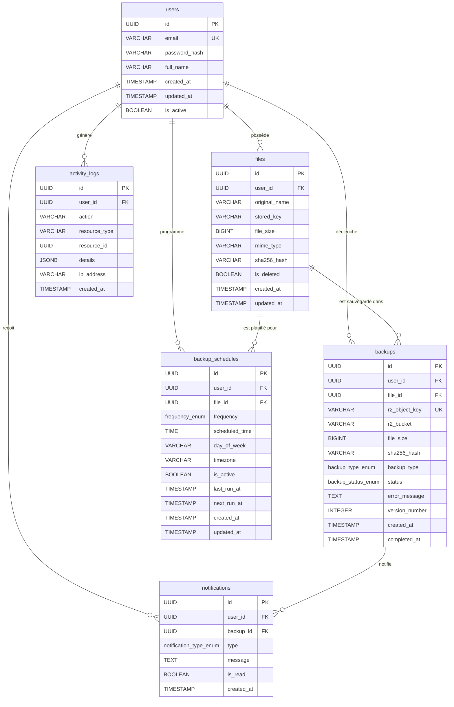
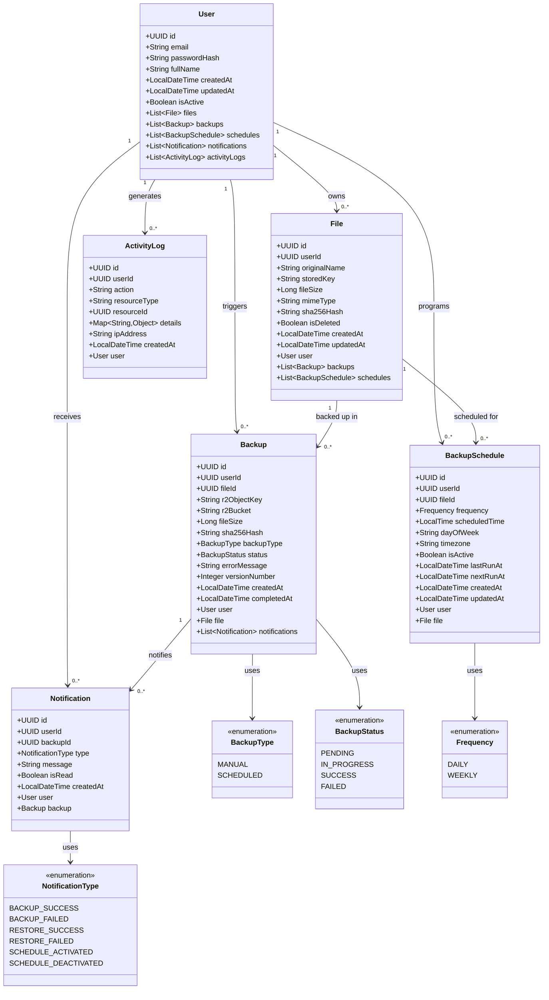

# SmartBackup — PHASE 1 : Modélisation Base de Données

> Stack : Spring Boot 3 + Java 21 · PostgreSQL sur Supabase · Flyway pour migrations

---

## Table des Matières

1. [Diagramme ERD (Mermaid)](#1-diagramme-erd)
2. [Diagramme de Classes UML (Mermaid)](#2-diagramme-de-classes-uml)
3. [Scripts SQL de Création des Tables](#3-scripts-sql)
4. [Scripts Flyway](#4-scripts-flyway)
5. [Description des Relations](#5-description-des-relations)
6. [Justification des Choix](#6-justification-des-choix)

---

## 1. Diagramme ERD



---

## 2. Diagramme de Classes UML



---

## 3. Scripts SQL

### Préambule — Types ENUM et Fonction updated_at

```sql
-- ============================================================
-- TYPES ENUM PostgreSQL
-- ============================================================
CREATE TYPE backup_type_enum AS ENUM ('MANUAL', 'SCHEDULED');
CREATE TYPE backup_status_enum AS ENUM ('PENDING', 'IN_PROGRESS', 'SUCCESS', 'FAILED');
CREATE TYPE frequency_enum AS ENUM ('DAILY', 'WEEKLY');
CREATE TYPE notification_type_enum AS ENUM (
    'BACKUP_SUCCESS',
    'BACKUP_FAILED',
    'RESTORE_SUCCESS',
    'RESTORE_FAILED',
    'SCHEDULE_ACTIVATED',
    'SCHEDULE_DEACTIVATED'
);

-- ============================================================
-- FONCTION TRIGGER : mise à jour automatique de updated_at
-- ============================================================
CREATE OR REPLACE FUNCTION set_updated_at()
RETURNS TRIGGER AS $$
BEGIN
    NEW.updated_at = NOW();
    RETURN NEW;
END;
$$ LANGUAGE plpgsql;
```

### Table `users`

```sql
CREATE TABLE users (
    id            UUID        PRIMARY KEY DEFAULT gen_random_uuid(),
    email         VARCHAR(320) NOT NULL UNIQUE,
    password_hash VARCHAR(255) NOT NULL,
    full_name     VARCHAR(255) NOT NULL,
    created_at    TIMESTAMP WITH TIME ZONE NOT NULL DEFAULT NOW(),
    updated_at    TIMESTAMP WITH TIME ZONE NOT NULL DEFAULT NOW(),
    is_active     BOOLEAN NOT NULL DEFAULT TRUE
);

CREATE TRIGGER trg_users_updated_at
    BEFORE UPDATE ON users
    FOR EACH ROW EXECUTE FUNCTION set_updated_at();
```

### Table `files`

```sql
CREATE TABLE files (
    id            UUID         PRIMARY KEY DEFAULT gen_random_uuid(),
    user_id       UUID         NOT NULL,
    original_name VARCHAR(500) NOT NULL,
    stored_key    VARCHAR(1000) NOT NULL,
    file_size     BIGINT       NOT NULL CHECK (file_size >= 0),
    mime_type     VARCHAR(255) NOT NULL,
    sha256_hash   VARCHAR(64)  NOT NULL,
    is_deleted    BOOLEAN      NOT NULL DEFAULT FALSE,
    created_at    TIMESTAMP WITH TIME ZONE NOT NULL DEFAULT NOW(),
    updated_at    TIMESTAMP WITH TIME ZONE NOT NULL DEFAULT NOW(),

    CONSTRAINT fk_files_user FOREIGN KEY (user_id)
        REFERENCES users(id) ON DELETE CASCADE
);

CREATE TRIGGER trg_files_updated_at
    BEFORE UPDATE ON files
    FOR EACH ROW EXECUTE FUNCTION set_updated_at();
```

### Table `backups`

```sql
CREATE TABLE backups (
    id             UUID                PRIMARY KEY DEFAULT gen_random_uuid(),
    user_id        UUID                NOT NULL,
    file_id        UUID                NOT NULL,
    r2_object_key  VARCHAR(1000)       NOT NULL UNIQUE,
    r2_bucket      VARCHAR(255)        NOT NULL,
    file_size      BIGINT              NOT NULL CHECK (file_size >= 0),
    sha256_hash    VARCHAR(64)         NOT NULL,
    backup_type    backup_type_enum    NOT NULL,
    status         backup_status_enum  NOT NULL DEFAULT 'PENDING',
    error_message  TEXT,
    version_number INTEGER             NOT NULL DEFAULT 1 CHECK (version_number >= 1),
    created_at     TIMESTAMP WITH TIME ZONE NOT NULL DEFAULT NOW(),
    completed_at   TIMESTAMP WITH TIME ZONE,

    CONSTRAINT fk_backups_user FOREIGN KEY (user_id)
        REFERENCES users(id) ON DELETE RESTRICT,
    CONSTRAINT fk_backups_file FOREIGN KEY (file_id)
        REFERENCES files(id) ON DELETE RESTRICT
);
```

### Table `backup_schedules`

```sql
CREATE TABLE backup_schedules (
    id             UUID            PRIMARY KEY DEFAULT gen_random_uuid(),
    user_id        UUID            NOT NULL,
    file_id        UUID            NOT NULL,
    frequency      frequency_enum  NOT NULL,
    scheduled_time TIME            NOT NULL,
    day_of_week    VARCHAR(10),
    timezone       VARCHAR(100)    NOT NULL DEFAULT 'UTC',
    is_active      BOOLEAN         NOT NULL DEFAULT TRUE,
    last_run_at    TIMESTAMP WITH TIME ZONE,
    next_run_at    TIMESTAMP WITH TIME ZONE,
    created_at     TIMESTAMP WITH TIME ZONE NOT NULL DEFAULT NOW(),
    updated_at     TIMESTAMP WITH TIME ZONE NOT NULL DEFAULT NOW(),

    CONSTRAINT fk_schedules_user FOREIGN KEY (user_id)
        REFERENCES users(id) ON DELETE CASCADE,
    CONSTRAINT fk_schedules_file FOREIGN KEY (file_id)
        REFERENCES files(id) ON DELETE CASCADE
);

CREATE TRIGGER trg_backup_schedules_updated_at
    BEFORE UPDATE ON backup_schedules
    FOR EACH ROW EXECUTE FUNCTION set_updated_at();
```

### Table `notifications`

```sql
CREATE TABLE notifications (
    id         UUID                    PRIMARY KEY DEFAULT gen_random_uuid(),
    user_id    UUID                    NOT NULL,
    backup_id  UUID,
    type       notification_type_enum  NOT NULL,
    message    TEXT                    NOT NULL,
    is_read    BOOLEAN                 NOT NULL DEFAULT FALSE,
    created_at TIMESTAMP WITH TIME ZONE NOT NULL DEFAULT NOW(),

    CONSTRAINT fk_notifications_user FOREIGN KEY (user_id)
        REFERENCES users(id) ON DELETE CASCADE,
    CONSTRAINT fk_notifications_backup FOREIGN KEY (backup_id)
        REFERENCES backups(id) ON DELETE SET NULL
);
```

### Table `activity_logs`

```sql
CREATE TABLE activity_logs (
    id            UUID        PRIMARY KEY DEFAULT gen_random_uuid(),
    user_id       UUID        NOT NULL,
    action        VARCHAR(100) NOT NULL,
    resource_type VARCHAR(100),
    resource_id   UUID,
    details       JSONB,
    ip_address    VARCHAR(45),
    created_at    TIMESTAMP WITH TIME ZONE NOT NULL DEFAULT NOW(),

    CONSTRAINT fk_activity_logs_user FOREIGN KEY (user_id)
        REFERENCES users(id) ON DELETE RESTRICT
);
```

### Index

```sql
-- Index sur user_id (toutes les tables)
CREATE INDEX idx_files_user_id              ON files(user_id);
CREATE INDEX idx_backups_user_id            ON backups(user_id);
CREATE INDEX idx_backup_schedules_user_id   ON backup_schedules(user_id);
CREATE INDEX idx_notifications_user_id      ON notifications(user_id);
CREATE INDEX idx_activity_logs_user_id      ON activity_logs(user_id);

-- Index sur file_id
CREATE INDEX idx_backups_file_id            ON backups(file_id);
CREATE INDEX idx_backup_schedules_file_id   ON backup_schedules(file_id);

-- Index sur status (backups)
CREATE INDEX idx_backups_status             ON backups(status);

-- Index sur created_at (toutes les tables)
CREATE INDEX idx_files_created_at           ON files(created_at);
CREATE INDEX idx_backups_created_at         ON backups(created_at);
CREATE INDEX idx_notifications_created_at   ON notifications(created_at);
CREATE INDEX idx_activity_logs_created_at   ON activity_logs(created_at);

-- Index sur is_read (notifications)
CREATE INDEX idx_notifications_is_read      ON notifications(is_read);

-- Index composite : unread notifications par user
CREATE INDEX idx_notifications_user_unread  ON notifications(user_id, is_read) WHERE is_read = FALSE;

-- Index JSONB (GIN) pour recherches dans details
CREATE INDEX idx_activity_logs_details      ON activity_logs USING GIN (details);

-- Index sur is_active (schedules)
CREATE INDEX idx_backup_schedules_active    ON backup_schedules(is_active) WHERE is_active = TRUE;

-- Index sur next_run_at (scheduler)
CREATE INDEX idx_backup_schedules_next_run  ON backup_schedules(next_run_at) WHERE is_active = TRUE;
```

---

## 4. Scripts Flyway

> **Convention** : fichiers placés dans `src/main/resources/db/migration/`

### V1\_\_create\_users\_table.sql

```sql
-- Migration V1 : Création de la table users + types ENUM + fonction updated_at
-- SmartBackup - PHASE 1

-- Types ENUM (créés une seule fois, utilisés par les migrations suivantes)
CREATE TYPE backup_type_enum AS ENUM ('MANUAL', 'SCHEDULED');
CREATE TYPE backup_status_enum AS ENUM ('PENDING', 'IN_PROGRESS', 'SUCCESS', 'FAILED');
CREATE TYPE frequency_enum AS ENUM ('DAILY', 'WEEKLY');
CREATE TYPE notification_type_enum AS ENUM (
    'BACKUP_SUCCESS',
    'BACKUP_FAILED',
    'RESTORE_SUCCESS',
    'RESTORE_FAILED',
    'SCHEDULE_ACTIVATED',
    'SCHEDULE_DEACTIVATED'
);

-- Fonction trigger updated_at
CREATE OR REPLACE FUNCTION set_updated_at()
RETURNS TRIGGER AS $$
BEGIN
    NEW.updated_at = NOW();
    RETURN NEW;
END;
$$ LANGUAGE plpgsql;

-- Table users
CREATE TABLE users (
    id            UUID         PRIMARY KEY DEFAULT gen_random_uuid(),
    email         VARCHAR(320) NOT NULL UNIQUE,
    password_hash VARCHAR(255) NOT NULL,
    full_name     VARCHAR(255) NOT NULL,
    created_at    TIMESTAMP WITH TIME ZONE NOT NULL DEFAULT NOW(),
    updated_at    TIMESTAMP WITH TIME ZONE NOT NULL DEFAULT NOW(),
    is_active     BOOLEAN NOT NULL DEFAULT TRUE
);

CREATE TRIGGER trg_users_updated_at
    BEFORE UPDATE ON users
    FOR EACH ROW EXECUTE FUNCTION set_updated_at();
```

### V2\_\_create\_files\_table.sql

```sql
-- Migration V2 : Création de la table files
-- SmartBackup - PHASE 1

CREATE TABLE files (
    id            UUID          PRIMARY KEY DEFAULT gen_random_uuid(),
    user_id       UUID          NOT NULL,
    original_name VARCHAR(500)  NOT NULL,
    stored_key    VARCHAR(1000) NOT NULL,
    file_size     BIGINT        NOT NULL CHECK (file_size >= 0),
    mime_type     VARCHAR(255)  NOT NULL,
    sha256_hash   VARCHAR(64)   NOT NULL,
    is_deleted    BOOLEAN       NOT NULL DEFAULT FALSE,
    created_at    TIMESTAMP WITH TIME ZONE NOT NULL DEFAULT NOW(),
    updated_at    TIMESTAMP WITH TIME ZONE NOT NULL DEFAULT NOW(),

    CONSTRAINT fk_files_user FOREIGN KEY (user_id)
        REFERENCES users(id) ON DELETE CASCADE
);

CREATE TRIGGER trg_files_updated_at
    BEFORE UPDATE ON files
    FOR EACH ROW EXECUTE FUNCTION set_updated_at();
```

### V3\_\_create\_backups\_table.sql

```sql
-- Migration V3 : Création de la table backups
-- SmartBackup - PHASE 1

CREATE TABLE backups (
    id             UUID                PRIMARY KEY DEFAULT gen_random_uuid(),
    user_id        UUID                NOT NULL,
    file_id        UUID                NOT NULL,
    r2_object_key  VARCHAR(1000)       NOT NULL UNIQUE,
    r2_bucket      VARCHAR(255)        NOT NULL,
    file_size      BIGINT              NOT NULL CHECK (file_size >= 0),
    sha256_hash    VARCHAR(64)         NOT NULL,
    backup_type    backup_type_enum    NOT NULL,
    status         backup_status_enum  NOT NULL DEFAULT 'PENDING',
    error_message  TEXT,
    version_number INTEGER             NOT NULL DEFAULT 1 CHECK (version_number >= 1),
    created_at     TIMESTAMP WITH TIME ZONE NOT NULL DEFAULT NOW(),
    completed_at   TIMESTAMP WITH TIME ZONE,

    CONSTRAINT fk_backups_user FOREIGN KEY (user_id)
        REFERENCES users(id) ON DELETE RESTRICT,
    CONSTRAINT fk_backups_file FOREIGN KEY (file_id)
        REFERENCES files(id) ON DELETE RESTRICT
);
```

### V4\_\_create\_backup\_schedules\_table.sql

```sql
-- Migration V4 : Création de la table backup_schedules
-- SmartBackup - PHASE 1

CREATE TABLE backup_schedules (
    id             UUID            PRIMARY KEY DEFAULT gen_random_uuid(),
    user_id        UUID            NOT NULL,
    file_id        UUID            NOT NULL,
    frequency      frequency_enum  NOT NULL,
    scheduled_time TIME            NOT NULL,
    day_of_week    VARCHAR(10),
    timezone       VARCHAR(100)    NOT NULL DEFAULT 'UTC',
    is_active      BOOLEAN         NOT NULL DEFAULT TRUE,
    last_run_at    TIMESTAMP WITH TIME ZONE,
    next_run_at    TIMESTAMP WITH TIME ZONE,
    created_at     TIMESTAMP WITH TIME ZONE NOT NULL DEFAULT NOW(),
    updated_at     TIMESTAMP WITH TIME ZONE NOT NULL DEFAULT NOW(),

    CONSTRAINT fk_schedules_user FOREIGN KEY (user_id)
        REFERENCES users(id) ON DELETE CASCADE,
    CONSTRAINT fk_schedules_file FOREIGN KEY (file_id)
        REFERENCES files(id) ON DELETE CASCADE
);

CREATE TRIGGER trg_backup_schedules_updated_at
    BEFORE UPDATE ON backup_schedules
    FOR EACH ROW EXECUTE FUNCTION set_updated_at();
```

### V5\_\_create\_notifications\_table.sql

```sql
-- Migration V5 : Création de la table notifications
-- SmartBackup - PHASE 1

CREATE TABLE notifications (
    id         UUID                    PRIMARY KEY DEFAULT gen_random_uuid(),
    user_id    UUID                    NOT NULL,
    backup_id  UUID,
    type       notification_type_enum  NOT NULL,
    message    TEXT                    NOT NULL,
    is_read    BOOLEAN                 NOT NULL DEFAULT FALSE,
    created_at TIMESTAMP WITH TIME ZONE NOT NULL DEFAULT NOW(),

    CONSTRAINT fk_notifications_user FOREIGN KEY (user_id)
        REFERENCES users(id) ON DELETE CASCADE,
    CONSTRAINT fk_notifications_backup FOREIGN KEY (backup_id)
        REFERENCES backups(id) ON DELETE SET NULL
);
```

### V6\_\_create\_activity\_logs\_table.sql

```sql
-- Migration V6 : Création de la table activity_logs
-- SmartBackup - PHASE 1

CREATE TABLE activity_logs (
    id            UUID         PRIMARY KEY DEFAULT gen_random_uuid(),
    user_id       UUID         NOT NULL,
    action        VARCHAR(100) NOT NULL,
    resource_type VARCHAR(100),
    resource_id   UUID,
    details       JSONB,
    ip_address    VARCHAR(45),
    created_at    TIMESTAMP WITH TIME ZONE NOT NULL DEFAULT NOW(),

    CONSTRAINT fk_activity_logs_user FOREIGN KEY (user_id)
        REFERENCES users(id) ON DELETE RESTRICT
);
```

### V7\_\_create\_indexes.sql

```sql
-- Migration V7 : Création de tous les index de performance
-- SmartBackup - PHASE 1

-- Index sur user_id (toutes les tables filles)
CREATE INDEX idx_files_user_id              ON files(user_id);
CREATE INDEX idx_backups_user_id            ON backups(user_id);
CREATE INDEX idx_backup_schedules_user_id   ON backup_schedules(user_id);
CREATE INDEX idx_notifications_user_id      ON notifications(user_id);
CREATE INDEX idx_activity_logs_user_id      ON activity_logs(user_id);

-- Index sur file_id (tables avec FK vers files)
CREATE INDEX idx_backups_file_id            ON backups(file_id);
CREATE INDEX idx_backup_schedules_file_id   ON backup_schedules(file_id);

-- Index sur status (filtrage des sauvegardes par état)
CREATE INDEX idx_backups_status             ON backups(status);

-- Index sur created_at (tri et pagination chronologique)
CREATE INDEX idx_files_created_at           ON files(created_at);
CREATE INDEX idx_backups_created_at         ON backups(created_at);
CREATE INDEX idx_notifications_created_at   ON notifications(created_at);
CREATE INDEX idx_activity_logs_created_at   ON activity_logs(created_at);

-- Index sur is_read (récupération des notifications non lues)
CREATE INDEX idx_notifications_is_read      ON notifications(is_read);

-- Index composite : notifications non lues par utilisateur
CREATE INDEX idx_notifications_user_unread
    ON notifications(user_id, is_read)
    WHERE is_read = FALSE;

-- Index GIN sur JSONB pour recherches dans activity_logs.details
CREATE INDEX idx_activity_logs_details
    ON activity_logs USING GIN (details);

-- Index partiels pour le scheduler (planifications actives uniquement)
CREATE INDEX idx_backup_schedules_active
    ON backup_schedules(is_active)
    WHERE is_active = TRUE;

CREATE INDEX idx_backup_schedules_next_run
    ON backup_schedules(next_run_at)
    WHERE is_active = TRUE;
```

---

## 5. Description des Relations

| Table source      | Relation   | Table cible       | Cardinalité | Contrainte FK             |
|-------------------|------------|-------------------|-------------|---------------------------|
| `files`           | appartient | `users`           | N → 1       | `ON DELETE CASCADE`       |
| `backups`         | créé par   | `users`           | N → 1       | `ON DELETE RESTRICT`      |
| `backups`         | sauvegarde | `files`           | N → 1       | `ON DELETE RESTRICT`      |
| `backup_schedules`| programmé par | `users`        | N → 1       | `ON DELETE CASCADE`       |
| `backup_schedules`| planifie   | `files`           | N → 1       | `ON DELETE CASCADE`       |
| `notifications`   | reçue par  | `users`           | N → 1       | `ON DELETE CASCADE`       |
| `notifications`   | liée à     | `backups`         | N → 1 (opt.)| `ON DELETE SET NULL`      |
| `activity_logs`   | générée par| `users`           | N → 1       | `ON DELETE RESTRICT`      |

### Justification des politiques ON DELETE

| Table             | Politique          | Raison                                                                                              |
|-------------------|--------------------|-----------------------------------------------------------------------------------------------------|
| `files`           | CASCADE (user)     | Si un utilisateur est supprimé, ses fichiers n'ont plus de raison d'exister.                       |
| `backups`         | RESTRICT (user/file)| Une sauvegarde est un actif critique. On interdit la suppression du parent tant que des backups existent. |
| `backup_schedules`| CASCADE (user/file)| La planification sans fichier ni utilisateur n'a aucun sens.                                       |
| `notifications`   | CASCADE (user)     | Les notifications appartiennent à l'utilisateur, supprimées avec lui.                              |
| `notifications`   | SET NULL (backup)  | On conserve la notification même si la sauvegarde est supprimée (audit léger).                     |
| `activity_logs`   | RESTRICT (user)    | Les journaux d'audit ne doivent pas disparaître avec l'utilisateur (conformité RGPD/audit trail).  |

---

## 6. Justification des Choix

### UUID vs Auto-incrément

| Critère               | UUID (`gen_random_uuid()`)                        | BIGSERIAL / SEQUENCE                      |
|-----------------------|---------------------------------------------------|-------------------------------------------|
| **Distribution**      | Idéal pour systèmes distribués / microservices    | Séquentiel, risque de collision en merge  |
| **Sécurité**          | Opaque : impossible de deviner l'id suivant       | Prévisible (énumération d'IDs)            |
| **Performances**      | Légèrement moins bon en clustering B-Tree         | Excellent (croissant)                     |
| **Interopérabilité**  | Compatible avec Cloudflare R2, JWT, logs externes | Conversion nécessaire                     |
| **Choix retenu**      | ✅ UUID v4 via `gen_random_uuid()`                | ❌                                        |

> [!TIP] PostgreSQL 13+ et Supabase supportent nativement `gen_random_uuid()` sans extension. Pour de meilleures performances d'index, envisager UUID v7 (trié) en phase future.

### JSONB pour `activity_logs.details`

| Critère               | JSONB                                              | Colonnes séparées                         |
|-----------------------|----------------------------------------------------|-------------------------------------------|
| **Flexibilité**       | Schéma variable selon le type d'action            | Schéma rigide, nombreuses colonnes NULL   |
| **Performances**      | Index GIN, opérateurs `@>`, `->>` natifs          | Index classiques, jointures               |
| **Évolutivité**       | Ajout de champs sans migration                    | ALTER TABLE requis                        |
| **Lisibilité**        | JSON natif dans les outils (Supabase Studio)      | Lisible en SQL classique                  |
| **Choix retenu**      | ✅ JSONB pour stocker les métadonnées d'action     | ❌                                        |

> [!NOTE] JSONB est binaire (Binary JSON) : plus rapide que JSON pour la lecture et les opérations d'indexation. Toujours préférer JSONB à JSON dans PostgreSQL.

### Soft Delete vs Hard Delete

| Table             | Stratégie      | Raison                                                                                      |
|-------------------|----------------|---------------------------------------------------------------------------------------------|
| `files`           | **Soft delete** (`is_deleted`) | Permet la restauration d'un fichier supprimé par erreur. Les backups associés restent valides. |
| `users`           | Hard delete via RESTRICT | Protégé par les FK RESTRICT sur `backups` et `activity_logs`. L'admin doit d'abord archiver les données. |
| `backups`         | Hard delete | Suppression physique, protégée par RESTRICT. Couplée à la suppression de l'objet R2.       |
| `activity_logs`   | Aucune suppression | Journal d'audit immuable. Archivage par rotation vers stockage froid en phase future.      |

> [!IMPORTANT] Le `is_deleted` sur `files` implique que toutes les requêtes applicatives doivent inclure `WHERE is_deleted = FALSE`. Prévoir un **Row Level Security (RLS)** Supabase ou un filtre au niveau du Repository JPA (`@Where(clause = "is_deleted = false")`).

### Indexation choisie

| Index                                    | Type    | Justification                                                              |
|------------------------------------------|---------|----------------------------------------------------------------------------|
| `idx_*_user_id`                          | B-Tree  | Requête pivot : « Toutes les données d'un utilisateur » — jointure constante |
| `idx_backups_file_id`                    | B-Tree  | Historique des sauvegardes d'un fichier                                    |
| `idx_backup_schedules_file_id`           | B-Tree  | Planifications actives d'un fichier                                        |
| `idx_backups_status`                     | B-Tree  | Filtrer les sauvegardes PENDING/IN_PROGRESS (dashboard, monitoring)        |
| `idx_*_created_at`                       | B-Tree  | Tri chronologique et pagination (LIMIT/OFFSET ou cursor-based)             |
| `idx_notifications_is_read`              | B-Tree  | Badge de notifications non lues                                            |
| `idx_notifications_user_unread` (partiel)| B-Tree  | Combinaison user + unread : index partiel réduit la taille de 50-80%      |
| `idx_activity_logs_details` (GIN)        | GIN     | Recherche dans le JSONB : `details @> '{"action": "UPLOAD"}'`             |
| `idx_backup_schedules_active` (partiel)  | B-Tree  | Le scheduler ne traite que les planifications actives                      |
| `idx_backup_schedules_next_run` (partiel)| B-Tree  | Tri par `next_run_at` pour déclencher la prochaine tâche planifiée         |

> [!WARNING] Ne pas sur-indexer : chaque index ralentit les écritures (INSERT/UPDATE). Les index partiels (`WHERE is_active = TRUE`, `WHERE is_read = FALSE`) sont un excellent compromis lecture/écriture pour ce schéma.

---

*Document généré pour SmartBackup — PHASE 1 | Ingénierie Base de Données*
